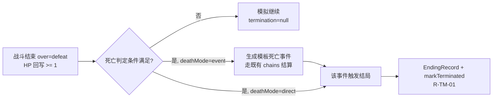

# 迭代 R2 设计规格（Design）

**版本：2026-11-11（R2.2 决策修订）｜状态：草案｜上游：`requirements.md`｜下游：`tasks.md`**

> **R2.1：时间穿越（S2 A3）延期至 R3。** §8 保留为草案、不作本轮实现依据；不落盘 ADR-0005、不新建 `time-travel.ts`。本轮仍需守住 §8 末的三个接口预留点。
>
> **R2.2（用户 2026-11-11 五项决策）**：① **退役六阶段 Lifecycle 状态机**，改以「开局完成标记 + 终止标记 + 归档只读」表达模拟结束（§3 重写）；② ADR 顺延 —— 本轮 ADR 为 **ADR-0004**（`docs/DECISIONS.md` 的 ADR-0003 已归属「组队战斗」），R3 时间穿越为 **ADR-0005**；③ 装备词条统一**动态补正**（§9.1）；④ HP 与死亡结局解耦，模拟中 HP ≥ 1，战败 + 条件 → 死亡事件或直接结局（§9.3）；⑤ 条件化 AI **只读公有字段**（§9.2）。`R-LC-01..06` 状态 `RETIRED`，新增 `R-TM-* / R-EN-07/08 / R-CA-06`；本轮仍 45 条 ACTIVE。
>
> **V1 legacy 已下线（2026-11-11 04:01）**：`game-core/src/` 下的 V1 引擎源码、`data/jjk.ts`、V1 测试与 `shared/src/legacy.ts` 已全部删除，仅保留 V2 共用的 `rng.ts`。本文件涉及 `evaluateLife` / legacy 评价的盘点、模块并存与过渡期条款已按此同步；阶段 0 报告为删除前快照，见该报告开头的「状态变更注记」。

本文件回答「怎么做、边界在哪、与既有决策如何对齐」。**接口名与文件落点均为建议**，实施前须按 `tasks.md` 阶段 0 对照工作区实际代码复核；改核心数据模型前必须先写 ADR（§12）。

------------------------------------------------------------------------

## 1. 设计目标与约束继承

1. 在现有 v2 引擎之上**增量接入模拟终止能力**，不推倒已实现的时间/事件/NPC/战斗模块；**不引入 Lifecycle 六阶段状态机**（R2.2 决策 ①）。
2. 开局、终止条件、结局、评价维度、装备栏、战斗风格、时间语义全部模板化。
3. 终止判定归 `ending.ts`，归档只读归 `archive.ts`，评价归 `life-evaluation.ts`；事件、时间各自保持单一职责，不设阶段编排层。
4. 确定性优先：所有新增随机（开局抽取、AI 评分决胜、动态补正求值）走注入 seed 的 RNG；穿越后重触发属 R3，不在本轮。
5. 继承 `AGENTS.md`、ADR-0001、ADR-0002 与附录 A 已接受决策，不重新讨论被否决项。
6. **时间穿越（S2 A3）延期至 R3**：本轮不实现、不写 ADR-0005，但必须保留 §8 末列出的三个接口预留点（Seam）。
7. **R2.2 三条产品规则**：装备词条动态补正且不写回基础属性；HP 与死亡结局解耦（HP ≥ 1）；条件化 AI 的条件求值只读公有字段。

## 2. 现状盘点（阶段 0 复核结果，2026-11-11）

> 本节由 `T0-01` / `tasks/reports/R2-GAP-ANALYSIS.md` 按**当时工作区实际代码**复核更新（仅静态审查，工具集无 Bash / 测试）。仓库存在另一 Agent 的 42 项未提交 WIP（v2 实现正在写入），结论可能随其提交而变化。行号均指该快照；路径缩写见报告 §0.1。

| 能力 | 现状文件（证据） | 复核结果 | R2 动作 |
|---|---|---|---|
| 模板协议 | `协议`（15 章） | 覆盖世界/角色/技能/物品/补正/事件/战斗；**无开局/结局/评价/装备/战斗 AI 章节**；§8 `type: equipment` 仅预留、引擎忽略（L295） | 扩章节（T1-03），不重写 |
| Schema | `schema/*.ts`（8 文件，`schema/index.ts:7-14`） | `WorldTemplateV2Schema.strict()`（`schema/world.ts:88-176`）仅 14 分域；**无 lifecycle/opening/ending/evaluation/equipment/combat-ai/event-instance** | 新增 7 个领域 schema 文件 |
| 时间 | `v2/time.ts:48-104` | ADR-0002 `TimeAdapter` **已落盘**（resolveStep/format/elapsedYears/resolveLifeStage）；但 `amountToMinutes/UNIT_MINUTES`（L18-30）为模块级硬编码、被 engine/turn 直接 import；接口无时间点解析/回拨语义 | 本轮不动；seam ② 缺口登记 `R3-PRE-02` |
| 事件 | `schema/event.ts:13-43,123-154`、`v2/turn.ts:130-135,147-165,239-271,337-346` | 池 + chains（仅 `active/completed`，`shared/v2.ts:133`）+ `nextEventId` + schedule 已实现；`source` 固定 4 类（`schema/event.ts:15`）；**事件为定义级，无 EventInstance/instanceId/definitionId/origin/status**（`shared/v2.ts:159`） | **保持现状**（A4/A5），仅加实例层 `origin`；seam ① 缺口登记 `R3-PRE-01` |
| 轮次 | `v2/turn.ts:378-461`（`advanceTurnV2`）、`:38-116`（`createWorldV2`） | 10 步轮次管线完整；**无终止门禁、无 termination/openingCompleted**（`shared/v2.ts:148-168`） | 增加 `assertActive()` 门禁（T2-02） |
| NPC | `v2/npc.ts:28-93`、`schema/npc-action.ts` | A6 触发式 + 效用评分（`pickBest` L73-86）**已实现**（非 WIP） | 复用其触发/评分设施（T6-01） |
| 战斗 | `v2/battle.ts`、协议 §10 | 回合状态机/preset 判定/控制白名单已实现；**HP 下限 1 已落地**（L405-407 `hp<=1 ⇒ hp=1, over=defeat`、L509 回写 `defeat ⇒ hp=1`、协议 §10「战斗中 HP 最低打到 1（不死）」）；敌人 AI 为 `aiTurn` 简单权重（L326-350）；**ADR-0003「组队战斗」阵营化已部分落地代码**（`team`/`allies` L24/L119），但 `DECISIONS.md:79-109` 仍标「待评审」 | 抽出 AI 决策层（T6-01）；HP 与死亡结局解耦只需补事件/结局路径（§9.3）；**ADR 编号冲突已于 R2.2 解决**：本轮 ADR-0004、R3 ADR-0005，ADR-0003 保留给组队战斗 |
| 投影 | `v2/projection.ts:16-117` | 补正按 `def.visibility === "known"` 过滤（L29/L125）；**NPC 未按 visibility 过滤（L91-99）、历史无 visibility 字段（`shared/v2.ts:137-146`）、`playerVisibleHistory`（`v2/turn.ts:459`）与 `/api/worlds/:id/history`（`server/index.ts:190-195`）全量返回** | 沿用并补齐 hidden 过滤；seam ③ 缺口登记 `R3-PRE-03` |
| 人生评价 | `v2/projection.ts:186-201`（`evaluateSummaryV2`）、`shared/v2.ts:268`（`V2Snapshot.evaluation`）；V1 `evaluateLife` 已下线 | **仅一份评价且嵌入投影**：单 `overall` + 世界观专名文本（L197-200）；只看最终属性面板、无 `evidenceIds`、无模板维度、无 LLM 总结 | **不重写**，新建 `life-evaluation.ts` 并解耦（T4-04/05），移除投影内现算调用；同步 `CORE_ENGINE §8` |
| 开局/结局/归档 | —（全仓 Grep 无 opening/ending/archive/EndingRecord/EvaluationRecord/TerminationRecord） | **完全缺失**；`createWorldV2` 无 `openingCompleted/openingId/termination`；无 `handoff`；无只读门禁（`server/store.ts:23` 无条件 save） | 新建 4 模块（T2/T3/T4，不含 `lifecycle.ts`） |
| 装备 | `schema/item.ts:9-23`、协议 §8 | 仅 `type: equipment` 枚举值（L12）；**无槽位/品质/词条/实例/穿脱**；`effectiveAttributes`（`v2/engine.ts:52-76`）**已是运行时求值**（基础值 + 补正 × 层数 + 心情档位，不写回 `state.player.attributes`），正好承接动态补正 | 规格落盘 + 接线（T5），不新增静态词条路径 |
| 战斗 AI | `v2/battle.ts:326-350`（`aiTurn`） | 简单权重策略（部分）；`private.combatHints.skillWeights`（`schema/character.ts:53`）为**私有**字段；`schema/common.ts:176` 已有 `visibility` 的 `"public"` / `"hidden"` 两档；无五步分层/风格/条件化策略，**亦无公有字段约束** | 分层决策独立模块（T6）+ `PublicConditionContext` 白名单 |
| 时间穿越 | `docs/DECISIONS.md:65`（ADR-0002 仅预留「实例-定义分离接口位」） | **缺失**；现状 `firedEvents`/`pendingEvents` 为定义级引用、`Math.max` 时间单调（`v2/engine.ts:312` / `v2/turn.ts:397`）、schedule 无实例状态 | **⛔ 延期 R3**：本轮仅保留 §8 末三个 seam，缺口登记 `R3-PRE-01/02/03` |

## 3. 终止模型（R2.2：不引入 Lifecycle 状态机）

### 3.1 架构决策与理由

> **决策（用户 2026-11-11）**：模拟终止确实需要新建，但**不引入「生命周期」概念**。原 `R-LC-01..06`（六阶段状态机 + `LifecycleState` + `PhaseTransitionLog`）整组 `RETIRED`，由 `R-TM-01..03` 取代。

代码事实：`advanceTurnV2` 是完整 10 步管线但没有「这局结束了」的判定；`finishBattle` 战败后仅把 HP 回写为 1 便继续模拟；`server/store.ts` 无条件 save。**缺失的是「终止」，不是「阶段编排」。**

| 六阶段状态机提供了什么 | 玩家/系统真正需要的 | R2.2 表达 |
|---|---|---|
| `CREATED` / `OPENING` 阶段枚举与门禁 | 开局没跑完不能推进轮次 | `openingCompleted: boolean` + `assertActive()`（R-TM-02） |
| `RUNNING → ENDING → EVALUATING → ARCHIVED` 迁移链 | 条件命中后停止行动、结算完当前事件、固化状态 | `TerminationRecord` + 幂等 `markTerminated()`（R-TM-01） |
| `PhaseTransitionLog` / 合法迁移表 / 阶段日志回放 | 归档后只读、评价不回写 | `archived` 只读标记（R-EV-06 / R-AR-02） |

**成本对比**：退役后省掉 1 个 `lifecycle.ts` 模块、1 个 `LifecycleState` 顶层字段、1 套迁移表与阶段日志、6 条需求，以及协议/UI 对 `phase` 的感知；`P2/P3` 两条正确性属性由「阶段序列合法」改写为「终止幂等 / 归档只读」，并新增 `P9`（HP ≥ 1）。三条玩家可见行为全部保留。R3 时间穿越的三个 seam（§8 末）只涉及事件实例、时间适配器与可见性，**不依赖 phase**，因此退役不会堵死 R3。

### 3.2 状态表达（二态 + 两个标记）


`WorldStateV2` 只新增三个并列字段（**ADR-0004 确认落点**）：

| 字段 | 类型 | 语义 |
|---|---|---|
| `openingCompleted` | `boolean` | 开局 `handoff` 完成后置 `true`；之前拒绝普通轮次 |
| `termination` | `TerminationRecord 或 null` | `null` = 运行；非 `null` = 已终止，含 `reason / worldTime / turnIndex / endingId? / source` |
| `archived` | `boolean` | 归档只读标记；为真时拒绝任何状态写入 |

**明确不做**：`Phase` 枚举、合法迁移表、`transition()` / `assertPhase()`、`PhaseTransitionLog`、`lifecycle.ts`、阶段序列回放断言（R-TM-03 静态检查）。

### 3.3 门禁与调用边界

- `advanceTurnV2` 入口调 `assertActive(state)`：`openingCompleted === false` ⇒ `NOT_ACTIVE`；`termination !== null` 或 `archived === true` ⇒ `TERMINATED`；两者都不改变世界状态。
- `ending.ts` 独占 `markTerminated()`（幂等）与 `checkTermination()`；事件结算边界由 `R-EN-02` 约束，命中后先结算完当前事件再写 `termination`。
- `life-evaluation.ts` 与 `archive.ts` 只读过程记录，不得回写 `state.player` / 结局；归档只读由 `archive.ts` 判定。
- 轮次引擎、事件引擎、UI 均不得自行判定「游戏是否开始/结束」——但仍**不需要**阶段编排模块。

## 4. 模块落点（建议，不新增 npm 包）

| 模块 | 文件 | 职责 |
|---|---|---|
| ~~Lifecycle~~ | ~~`packages/game-core/src/v2/lifecycle.ts`~~ | **⛔ R2.2 不创建**（决策 ①，R-TM-03 静态检查） |
| Opening | `.../v2/opening.ts` | 步骤执行、事件池抽取、初始化编排、`handoff` 与 `openingCompleted` |
| Ending | `.../v2/ending.ts` | 终止条件检查、`markTerminated()` / `assertActive()`、结局筛选与固化、战败→死亡路径（§9.3） |
| Evaluation | `.../v2/life-evaluation.ts` | 维度评分、证据收集、总结编排（取代投影内现算评价；V1 legacy 评价已下线，无并存过渡期） |
| Archive | `.../v2/archive.ts` | 归档组装与 `archived` 只读判定 |
| Time Travel | ~~`.../v2/time-travel.ts`~~ | **⛔ 延期 R3，本轮不创建** |
| Equipment | `.../v2/equipment.ts` | 槽位校验、实例管理、**动态补正求值**（不写回基础属性） |
| Combat AI | `.../v2/combat-ai.ts` | 五步决策、风格解析、条件化策略（只读 `PublicConditionContext`） |
| Schema | `packages/shared/src/schema/{opening,ending,evaluation,equipment,combat-ai,event-instance}.ts` | Zod 定义；`TerminationRecord` 并入 `ending.ts`，不新增 `lifecycle.ts` / `termination.ts`；`event-instance` 本轮只用 `origin`，`world-line.ts` 属 R3 |
| 模板分域 | `specs/data/templates/<world-id>/{opening,endings,evaluation,equipment,combat-ai}.yaml` | 新增分域；`items.yaml` 的 `type: equipment` 扩字段 |

`apps/server` 只负责加载 YAML → Zod 校验 → 注入引擎；`apps/web` 只消费投影结果，不承载终止权威判定。

## 5. 数据模型（逻辑边界，非数据库表）

| 类型 | 关键字段 | 生命周期 |
|---|---|---|
| `OpeningTemplate` | `openingId, name, description, entryConditions, steps[], characterSetup, worldSetup, npcSetup, eventPools[], objectives, choices, completionConditions, handoff` | 模板只读 |
| `OpeningRun` | `openingId, executedSteps[], choiceRecords[], seed, startedAt, completedAt` | 本局 |
| `TerminationRecord`（R2.2 新增） | `reason, worldTime, turnIndex, endingId?, source` | 本局，固化后只读；取代 `PhaseTransitionLog` |
| `EndingCondition` | `type, params, combinator(AND/OR), terminationMode(immediate/afterSettle)`；`type` 含 `battleDefeat`（R2.2 决策 ④） | 模板只读 |
| `DeathRoute`（R2.2 新增） | `deathMode: event 或 direct, deathEventId?, conditions[]` | 模板只读；见 §9.3 |
| `EndingTemplate` | `endingId, triggerConditions, priority, endingType, narrativeConfig, visibility, exclusiveGroup, fallback` | 模板只读 |
| `EndingRecord` | `endingId, evidenceIds[], title, summary, narrativeSource(template/llm/fallback)` | 本局，固化后只读 |
| `EvaluationConfig` | `dimensions[{id,label,weight,ranges,explainRules}], worldSpecificDimensions[]` | 模板只读 |
| `EvaluationRecord` | `dimensions[{id,score,level,explanation,evidenceIds[]}], overall?, summary, summarySource` | 本局，只读 |
| `EventDefinition` | 模板中的原始事件定义 | 模板只读；本轮只要求「定义 / 实例可区分」（R3 穿越的 seam） |
| `EventInstance` | `instanceId, definitionId, origin{kind,id}, scheduledTime?, status, visibility` | 本局；**本轮只写 `origin`**，穿越语义属 R3 |
| `EventRecord` | `instanceId, actualOccurredTime, outcome` | **⛔ R3 延期**，本轮不引入 |
| `EquipmentDefinition` | `itemId, slot, quality, category, dynamicModifier{preset, params, conditions[]}` | 模板只读；**统一动态补正**（R2.2 决策 ③） |
| `EquipmentInstance` | `itemId, ownerId, slot, stacks?, durability?` | 本局；**不存补正结果** |
| `DynamicModifierSpec` | `preset, params, conditions[]`（preset 取自既有白名单，含 `stack-scaled` 层数读取） | 模板只读；求值在 `effectiveAttributes()` 内完成 |
| `CombatStyleProfile` | `styleId, candidateFilters[], scoreWeights{}, conditions[]` | 模板只读 |
| `PublicConditionContext`（R2.2 新增） | 投影可见字段 + `visibility: "public"` 日志/效果 + 已公开战斗状态 | 每次决策由 `combat-ai.ts` 生成，**不含完整 `WorldStateV2`** |
| `WorldLineRecord` | `worldLineId, parentWorldLineId, divergenceTime, jumpSeq, rngSeedDerived` | **⛔ R3 延期**，本轮不引入 |

`origin{kind,id}` 是**实例级元数据**，用于把开局事件标为 `opening + openingId`，不新增 `source` 枚举（对齐 A5）。`WorldStateV2` 只并列新增 `openingCompleted / termination / archived` 三个字段（§3.2，需 ADR-0004）。

## 6. 关键接口（TS 签名示意，非既定）

```ts
// ending.ts —— R2.2：终止标记与门禁取代 lifecycle.ts
type TerminationRecord = {
  reason: string; worldTime: unknown; turnIndex: number;
  endingId?: string; source: 'condition' | 'player' | 'battleDefeat' | 'event';
};
function assertActive(state: WorldStateV2): void;              // NOT_ACTIVE / TERMINATED
function markTerminated(state: WorldStateV2, rec: TerminationRecord): Result<WorldStateV2>; // 幂等

// opening.ts
function runOpening(state: WorldStateV2, tpl: OpeningTemplate, ctx: RunnerContext): Result<OpeningRun>;
function drawOpeningEvents(pool: EventPool, rng: Rng, ctx: ConditionContext): EventInstance[];
function handoff(state: WorldStateV2, run: OpeningRun): Result<WorldStateV2>; // 置 openingCompleted

// ending.ts（结局筛选）
function checkTermination(state: WorldStateV2, tpl: EndingCondition[], boundary: Boundary): boolean;
function resolveEnding(state: WorldStateV2, tpls: EndingTemplate[], ctx: RunnerContext): EndingRecord;
function resolveDeathRoute(route: DeathRoute, ctx: ConditionContext): 'event' | 'direct' | null; // §9.3

// life-evaluation.ts
function evaluateLifeV2(state: WorldStateV2, cfg: EvaluationConfig): EvaluationRecord;
function collectEvidence(state: WorldStateV2, dimensionId: string): EvidenceRef[];

// equipment.ts —— 动态补正，无写回
function evaluateDynamicModifier(spec: DynamicModifierSpec, ctx: ModifierContext): Record<string, number>;

// combat-ai.ts —— 只读公有字段
type PublicConditionContext = ReturnType<typeof buildPublicConditionContext>;
function decide(state: BattleState, pub: PublicConditionContext, profile: CombatStyleProfile, rng: Rng): Decision;

// time-travel.ts —— ⛔ R3 延期，本轮不实现、不导出
// function jumpTo(state: WorldStateV2, target: TimePoint, ctx: RunnerContext): Result<WorldStateV2>;
```

`RunnerContext` 统一承载 `rng / now / idFactory`（`AGENTS.md` §2：时间、随机数、ID 必须可注入），所有新模块一律纯函数 + adapter 层副作用。`buildPublicConditionContext` 是唯一允许把世界状态喂给条件求值的入口。

## 7. 与既有决策的冲突对齐（重点）

| # | 新文档措辞 | 既有决策 | 本设计取舍 |
|---|---|---|---|
| C1 | 「当前事件进入事件栈」「未来事件进入未来事件队列」（S1 §3.5） | 附录 A A4：**保持现状，不引入事件栈**，维持事件池 + chains + `nextEventId` + schedule | 语义映射：`handoff` 把连续事件接到现有 chains，定时/条件事件接到 schedule；**不建栈模块** |
| C2 | 「事件实例记录来源 `opening`」（S1 §3.5） | 附录 A A5：语义复用，不加枚举 | 用 `EventInstance.origin` 元数据，`source` 枚举不动 |
| C3 | 「通用基础属性 / 默认公式可覆写」（增量说明 §六，被 S2 A8/A9 记录） | ADR-0002 §7/§8：维持纯自定义属性层与 preset 白名单、拒绝自由 DSL | 装备与战斗 AI **不引入** ATK/DEF/CRIT 语义，效果走 `effectiveAttributes` + preset |
| C4 | 「战斗风格配置化」（S2 A11） | ADR-0001 §4：控制语义为引擎固定白名单 | 风格解析为权重/过滤参数，**不改控制语义与判定白名单** |
| C5 | 「装备效果走效果系统」（增量说明 §七） | ADR-0001 §2：声明式效果 DSL | 复用协议 §12 DSL 与 `effectiveAttributes()` 运行时求值；动态补正只认 preset 白名单，**不新增自由表达式求值器、不写回基础属性**（决策 ③） |
| C6 | 「时间穿越」（S2 A3） | ADR-0002 后果：仍 P4 单独立项，已预留实例-定义分离接口位 | **⛔ 延期 R3**：恢复附录 A「本次不做」；本轮不写 ADR-0005、不做穿越实现，仅保留 §8 末接口 seam |
| C7 | 「人生评价」 | `v2/projection.ts` 的 `evaluateSummaryV2` / `CORE_ENGINE.md` §8 | 新建 `life-evaluation.ts` 取代投影内现算评价；V1 `evaluateLife` 已于 2026-11-11 下线、不再保留过渡期；同步更新 §8 |
| C8 | 「Lifecycle 统一管理阶段」（S1 §2） | 现有 `WorldStateV2` 无阶段字段；用户 2026-11-11 决定「不一定需要生命周期概念」 | **⛔ 整组 RETIRED**：不建 `LifecycleState` / `lifecycle.ts`；改以 `openingCompleted / termination / archived` 三字段（§3），仍需 ADR-0004 确认落点 |
| C9 | 「七个事件类型」（增量说明 §3.2） | 附录 A A5：不加枚举 | 本轮不采纳；开局/结局标签走 `origin` 与模板 tag |
| C10 | 「HP 归零 → 死亡」（S3 #11 的旧假设） | `v2/battle.ts:405-407/509` 与协议 §10 已把 HP clamp 到 1（不死） | **决策 ④**：HP 与死亡结局解耦；战败 + 条件 → 死亡事件或直接结局（§9.3），HP 不作判据 |
| C11 | 「按玩家属性针对性选技能」（S3 #13） | `combatHints` 为私有字段；`R-NFR-04` 禁止隐藏信息进投影 | **决策 ⑤**：条件化 AI 只读 `PublicConditionContext` 公有字段；引用私有字段的模板在加载期拒绝（§9.2） |
| C12 | R2 的 ADR 编号 | `docs/DECISIONS.md:82` 已有 ADR-0003「组队战斗（待评审草案）」且已部分落地 `battle.ts` | **决策 ②**：不改动该草案；本轮 ADR 顺延为 **ADR-0004**，R3 时间穿越为 **ADR-0005**（阶段 0 报告 §6.1 的冲突描述为历史状态） |

## 8. 时间穿越语义设计 — ⛔ 延期（R3），本节仅为草案

> **状态：`DEFERRED`。** 用户 2026-11-11 决定时间穿越继续延期，与附录 A A3、ADR-0002 的 P4 立项一致。**本节不作为本轮实现、测试或 ADR 的依据**（R3 的 ADR 编号为 **ADR-0005**），保留供 R3 直接复用；对应需求见 `requirements.md` §F，任务见 `tasks.md` 附录 A。

**三层存储**：`EventDefinition`（模板只读）／`EventInstance`（本局，可变状态）／`EventRecord`（append-only 已发生事实）。ADR-0002 预留的接口位即此处的 `instanceId / definitionId` 分离。

**回拨算法**（`jumpTo`，全部在同一个事务式状态变换内）：

1. 经 `TimeAdapter` 解析目标时间点，校验目标是否合法（模板可声明是否允许回拨）。
2. 保留全部 `EventRecord`，其 `actualOccurredTime` 不改写。
3. 扫描 `scheduledTime > target` 或状态为 `executed` 但发生在回拨区间内的 `EventInstance`：
   - 未执行 ⇒ `status = undone`；
   - 主角/亲友/重要 NPC 相关 ⇒ 同时 `visibility = hidden`；
   - **不删除 `EventDefinition`**。
4. 生成 `WorldLineRecord`（`parentWorldLineId`、`divergenceTime`、递增 `jumpSeq`）。
5. 从 `(主 seed, jumpSeq, divergenceTime)` 派生子 RNG，供后续重触发使用（保证 R-TT-06）。
6. 按新世界状态重新评估条件与 schedule；新事件生成新的 `instanceId`，不复用旧 ID。
7. 写阶段日志与穿越日志，返回新状态。

**可见性**：`hidden` 实例不进 `projection.ts` 输出（R-NFR-04）；服务端内部可查询以支持世界线回顾。

**不做**：分支世界的独立存档实体（待决）、自动合并世界线、跨世界线的评价比较。

**本轮必须保留的三个接口预留点（Seam，属 `ACTIVE` 约束）**：

1. `EventInstance` 具备独立 `instanceId` 与 `definitionId`，模板定义与本局实例可区分；本轮 `origin` 元数据不得与这两者耦合。
2. 一切时间换算只经 `TimeAdapter`，`game-core` 不得写死「时间单调递增」或「未来事件永不撤销」的假设；schedule 事件保留可撤销的状态字段空间。
3. 玩家投影按 `visibility` 字段过滤，未来新增隐藏语义只加字段值、不改投影函数结构。

> 这三点是「延期但不堵死」的验收点：`tasks.md` T0-01 差距报告需核查现状是否已具备，缺口记为 **R3 前置改造项**，本轮不补实现。

## 9. 装备 / 战斗 AI / 死亡结局的最小模型

### 9.1 装备：统一动态补正（R2.2 决策 ③；对应 R-EQ-03 / R-EQ-04 / R-EQ-05 / R-EQ-06）

- 模板：`world.yaml` 或 `equipment.yaml` 声明 `slots[]`（id/label/allowedCategories/maxCount）；`items.yaml` 的 `type: equipment` 扩 `slot / quality / dynamicModifier`。**不再提供 `modifierMode: static | dynamic` 二选一**。
- **动态补正**：词条不是固化数值，而是每次结算时由 `evaluateDynamicModifier(spec, ctx)` 按当前状态求值。`ctx` 含当前补正层数、心情档位、条件命中、世界/战斗状态；`spec.preset` 只能取既有白名单（协议 §10 已具备 `base + stacks * perStack` 的 `stack-scaled`），**不接受自由表达式**（ADR-0001/0002）。
- 求值结果并入 `effectiveAttributes()` 的累加链（基础值 → 状态补正 × 层数 → 装备动态补正 → 心情档位 → caps），**不写回 `state.player.attributes`、不写入 `EquipmentInstance`**。固定值只是「无条件、无层数」的退化 preset，仍走同一管线。
- `attributeModifiers.perStack`（S3 #18 通用属性补正模型）仍属延期；模板若使用该字段须明确报错，不得静默忽略。
- 接线点：穿脱经 Zod 校验槽位冲突（R-EQ-05）；同 seed 回放要求动态补正序列逐次相等（R-NFR-01）。

### 9.2 战斗 AI：条件只读公有字段（R2.2 决策 ⑤；对应 R-CA-01 / R-CA-03 / R-CA-06）

**五步（`combat-ai.ts`）**：① 规则约束（控制语义/资源/CD 过滤，只用已注册 actionId）→ ② 候选集 → ③ 评分（`scoreWeights` + 条件化策略 + 可选注入 RNG 扰动）→ ④ 最高分选择（平局按模板决胜，默认稳定排序）→ ⑤ 交回 `battle.ts` 既有结算路径，AI 不自行写状态。

**可见性边界**：条件求值的唯一输入是 `PublicConditionContext` = 玩家端投影可见字段 + `visibility === "public"` 的日志/效果（`schema/common.ts:176`） + 该阵营已公开的战斗状态。**禁止**读取 `hidden` / `unknown` / `secrets`、`combatHints`（敌方私有）、NPC 私有目标（如 `knownGoals`）、完整 `WorldStateV2`、服务端内部状态。模板里出现非公有字段引用时，Zod / 协议校验在**加载期**拒绝并给出字段路径（R-CA-06），而不是运行时静默降级。风格名不得出现在引擎分支里（R-CA-02）。

### 9.3 死亡结局与 HP 解耦（R2.2 决策 ④；对应 R-EN-07 / R-EN-08）

**现状已具备**：`v2/battle.ts:405-407` 在 `hp <= 1` 时置 `hp = 1` 并 `over = "defeat"`；`:509` 回写 `state.player.hp = defeat ? 1 : Math.max(1, hp)`；`v2/engine.ts:269` 资源效果 `clamp(..., 1, maxHp)`；协议 §10 明写「战斗中 HP 最低打到 1（不死）；善后由胜负结算效果承担」。因此**模拟中 HP 不会归零**，HP 从来不是死亡判据（R-EN-07）。

**死亡结局路径**（模板 `DeathRoute` 声明，引擎不硬编码）：



- 两条路径都不改写 HP、不绕过 `R-TM-01` 的终止标记，也不新增事件类型枚举（死亡事件用既有 `source` + 模板 tag 表达，对齐 A5）。
- 战败但条件不满足时模拟继续；重伤/昏迷等程度由模板以补正或事件效果表达，不引入「HP 归零」语义。
- NPC 侧死亡实体语义（`docs/OPEN_QUESTIONS.md #21/#22`）仍未决，本轮不在引擎层给 NPC 加存活状态机。

## 10. AI 边界与失败回退

| 环节 | 允许 | 禁止 | 失败处理 |
|---|---|---|---|
| 结局叙事 | 基于已确认事件/关系/最终状态组织文字 | 创造未发生事实、改状态、补写选择 | Zod 结构校验失败 ⇒ 回退模板文本/变量填充（R-EN-06） |
| 人生总结 | 把 `EvaluationRecord` 的证据组织成自然语言 | 决定分数、改写维度或证据 | 同上（R-EV-05 / R-NFR-03） |
| 全链路 | 超时/不可用不阻塞终止与归档 | — | 归档仍可达，记录 `summarySource: fallback` |

LLM 输出 schema 与模板文本回退实现放在 adapter 层（`apps/server` / provider adapter），`game-core` 只接收已校验的结构化结果。

## 11. 正确性属性（用 Vitest 参数化/回放覆盖，不引入新测试框架）

| ID | 属性 | 对应需求 |
|---|---|---|
| P1 | 任意合法状态变换前后，同 seed 重放结果逐字段相等（不含阶段序列） | R-NFR-01 |
| P2 | `markTerminated()` 幂等且不可逆：终止后 `termination` 不再变化，重复调用不追加记录 | R-TM-01 / R-TM-03 |
| P3 | 终止并归档后任何写操作都不改变状态，评价不回写结局 | R-TM-01 / R-EV-06 / R-AR-02 |
| P4 | ⛔ **R3 延期**：任意回拨后 `EventDefinition` 集合相等、`EventRecord` 只增不减 | R-TT-01/02/03（DEFERRED） |
| P5 | 玩家投影中永不出现 `hidden/unknown` 条目 | R-NFR-04（本轮）；R-TT-04（R3） |
| P6 | 每条评价证据 ID 都能在本局事件历史/选择记录中解析 | R-EV-04 |
| P7 | AI 决策输出的 actionId 必属于候选集、候选集 ⊆ 已注册行动，且条件求值只引用公有字段 | R-CA-01/05/06 |
| P8 | 装备结算不改变 preset 白名单与控制语义集合，且动态补正不写回基础属性 | R-EQ-03/04/06 |
| P9 | 任意战斗/事件结算后 `state.player.hp >= 1`，且 HP 从未作为终止判据 | R-EN-07/08 |

本轮回归套件覆盖 **P1–P3、P5–P9 共 8 项**；P4 随 A3 延期，不计入完成门槛。

## 12. 需 ADR / 协议修订清单（阶段 1 完成前不得进入编码）

| 项 | 内容 | 影响 |
|---|---|---|
| **ADR-0004**（R2.2 顺延） | **终止模型**：`openingCompleted / termination / archived` 三字段在 `WorldStateV2` 中的落点、`assertActive()` 门禁对轮次管线的影响、**明确否决六阶段 Lifecycle 状态机**（含替代方案与迁移成本）；覆盖新增 `TerminationRecord` 与 `DeathRoute` | 核心数据模型变更（R-TM-* / R-EN-07/08） |
| ~~**ADR-0005**~~ | **⛔ 延期 R3**：时间穿越语义（三层事件存储、世界线、隐秘化、RNG 派生、分支存档） | 本轮**不落盘、不计入阶段 1**；接续 ADR-0002 的工作移至 R3 |
| 协议 V2.1 修订 | `TEMPLATE_PROTOCOL_V2.md` 新增开局/结局/评价/装备/战斗 AI 章节（**不含时间穿越、不含阶段状态机**）；扩 §8 items 的 `dynamicModifier`、§13 校验清单（含条件化 AI 公有字段白名单）、§14 测试清单 | 模板作者契约 |
| 规格同步 | `specs/engine/CORE_ENGINE.md` §8 人生评价标注由新规格取代；`docs/OPEN_QUESTIONS.md` #9/#11/#13 登记为**已决**（决策 ③④⑤）、#27 编号冲突登记为**已解决**、#21/#22 NPC 死亡语义保持待决 | 避免双份事实来源 |
| 编号归属声明 | `docs/DECISIONS.md` 的 **ADR-0003「组队战斗」保持原编号**（待评审草案，已部分落地 `battle.ts`）；本轮不改动该草案，仅顺延 R2/R3 编号 | 消除阶段 0 报告 §6.1 的冲突 |

> 阶段 1 本轮只需 **ADR-0004**；装备词条、HP/死亡路径、条件化 AI 可见边界三项产品规则**已由用户决策收敛并登记在 `OPEN_QUESTIONS.md`，无需追加 ADR**（仍须在协议 V2.1 中落地校验规则）。`design.md` §8 与 `requirements.md` §F 的穿越内容保持草案状态，不触发协议修订。

## 13. 测试策略

**三层**：单元（终止门禁/抽取/决胜/评分/槽位/动态补正/决策五步）→ 契约与回放（P1–P3、P5–P9、同 seed 全链路）→ 跨模板剧本（补充方案 §7 的 12 个场景 + 遗留两项：装备、战斗 AI）。

必须覆盖的剧本：

1. 同一世界观不同开局、固定开局 + 随机事件、开局事件链、开局互斥事件。
2. 多终止条件同时满足、无专属结局命中、隐藏结局、玩家主动结束、事件结算中触发结束；**战败 → 死亡事件 / 直接结局两条路径**、战败但条件不满足继续模拟、HP 全程 ≥ 1。
3. 结局与评价独立、评价可追溯、LLM 输出异常回退。
4. 装备：栏位冲突、**动态补正随状态/层数变化**、卸下后补正消失、基础属性不被写回、非白名单字段与 `perStack` 拒绝。
5. 战斗 AI：三种风格差异、低血治疗条件、**引用隐藏字段的模板在加载期被拒**、非法 actionId 回退。
6. ~~时间穿越：未来事件撤销、原始定义保留、隐秘化不进投影、按新状态重触发、同 seed 复现~~ **⛔ 延期 R3**（见 `tasks.md` 附录 A）。
7. 三世界观验收：咒术回战（剧情开局/关系/战斗结局）、现代人生模拟器（年龄阶段/长期目标/多维评价）；Steins;Gate 本轮只验证历法与模板可表达差异，**不测时间穿越**（其为 R3 架构试金石）。
8. **无 Lifecycle 静态检查**：`game-core/src/v2/` 无 `lifecycle.ts` / `Phase` / `PhaseTransitionLog`，回放断言不依赖阶段序列（R-TM-03）。

## 14. 风险与缓解

| 风险 | 缓解 |
|---|---|
| 终止标记落点侵入 `WorldStateV2` 导致大量既有签名改动 | 采用并列 `openingCompleted / termination / archived` 三字段，纯函数签名不变；**ADR-0004** 先评审；不引入 `LifecycleState` |
| 退役 Lifecycle 后，「开局未完/已终止/已归档」三态判定散落各处 | `assertActive()` 单一入口 + `ending.ts` 独占 `markTerminated()` + `archive.ts` 独占只读判定；`R-TM-03` 静态检查兜底 |
| 开局事件复用既有链/池时语义含糊 | C1 映射表 + `handoff` 单一入口 + 契约测试 |
| 评价逻辑仍嵌在 `projectSnapshotV2`，新模块接线后可能留下双份调用 | 新建 `life-evaluation.ts` 后移除投影内 `evaluateSummaryV2` 调用，保证唯一事实来源；同步 CORE_ENGINE §8 |
| 动态补正被实现成「把结果写回属性」，破坏可复现与穿脱语义 | `evaluateDynamicModifier()` 纯求值并入 `effectiveAttributes()`；测试断言穿脱前后基础属性逐字段不变（P8） |
| 条件化 AI 读到 `combatHints` / 隐藏属性造成信息泄漏 | `PublicConditionContext` 唯一入口 + 模板加载期字段白名单校验 + 投影渗透测试（P5/P7） |
| 实现方把 HP 归零当死亡触发，推翻既有 clamp 语义 | R-EN-07 静态检查 + P9 属性测试；死亡只走 §9.3 的 `DeathRoute` |
| 时间穿越延期后，本轮新增结构把接口写死，R3 接入需重构 | 落实 §8 末三个 seam（与 phase 无关）；T0-01 差距报告核查现状，缺口记入 R3 前置改造项 |
| 多 Agent 并发写同一 `packages/` 文件 | 任务清单标注文件归属；同一时刻只允许一个 Agent 写实现 |
| LLM 不可用导致流程卡死 | 全链路回退（§10），终止后仍可完成评价与归档 |

