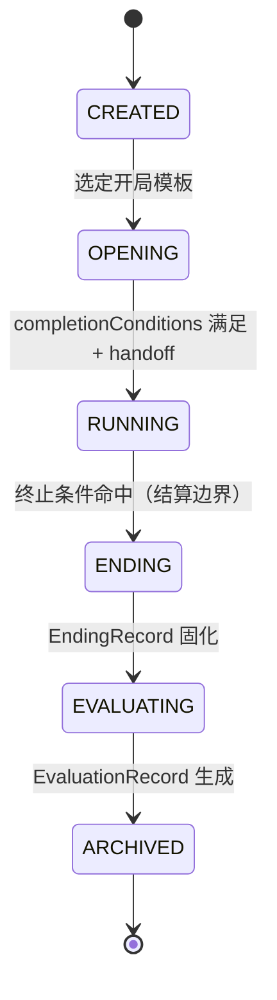

# 迭代 R2 设计规格（Design）

**版本：2026-11-11｜状态：草案｜上游：`requirements.md`｜下游：`tasks.md`**

本文件回答「怎么做、边界在哪、与既有决策如何对齐」。**接口名与文件落点均为建议**，实施前须按 `tasks.md` 阶段 0 对照工作区实际代码复核；改核心数据模型前必须先写 ADR（§12）。

------------------------------------------------------------------------

## 1. 设计目标与约束继承

1. 在现有 v2 引擎之上**增量接入** Lifecycle，不推倒已实现的时间/事件/NPC/战斗模块。
2. 开局、终止条件、结局、评价维度、装备栏、战斗风格、时间语义全部模板化。
3. 生命周期只做阶段编排；事件、时间、评价各自保持单一职责。
4. 确定性优先：所有新增随机（开局抽取、AI 评分决胜、穿越后重触发）走注入 seed 的 RNG。
5. 继承 `AGENTS.md`、ADR-0001、ADR-0002 与附录 A 已接受决策，不重新讨论被否决项。

## 2. 现状盘点（实施前须复核）

> 落盘时工作区有另一 Agent 的 v2 WIP 未提交，下表按当时文件快照整理；阶段 0 差距报告必须以**当时实际代码**为准更新此表。

| 能力 | 现状文件 | 已有 | R2 动作 |
|---|---|---|---|
| 模板协议 | `specs/data/TEMPLATE_PROTOCOL_V2.md`（15 章） | YAML 分域、三段式事件、链/池、preset 白名单 | 扩章节，不重写 |
| Schema | `packages/shared/src/schema/*.ts`（world/character/event/item/skill/status-effect/npc-action） | Zod 为单一事实来源 | 新增领域 schema 文件 |
| 时间 | `packages/game-core/src/v2/time.ts` | ADR-0002 时间适配器化（已落盘，待实施） | 穿越需在其上扩展 |
| 事件 | `schema/event.ts`、协议 §9 | 池 + chains + `nextEventId` + schedule | **保持现状**，只加实例层元数据 |
| 轮次 | `v2/turn.ts`、`v2/engine.ts` | 轮次管线、条件/效果结算 | 增加阶段门禁 |
| NPC | `v2/npc.ts`、`schema/npc-action.ts` | 触发式 + 效用评分（本轮另一 Agent 实施中） | 复用其触发/评分设施 |
| 战斗 | `v2/battle.ts`、协议 §10 | 回合状态机、preset 判定、控制白名单 | 抽出 AI 决策层 |
| 投影 | `v2/projection.ts` | 可见性投影 | 新增隐秘未来事件过滤 |
| 人生评价 | `packages/game-core/src/evaluation.ts`（legacy，`evaluateLife`） | 基础规则评分 | **不重写**，新增独立评价模块并逐步迁移 |
| 开局/结局/归档 | — | **缺失** | 新建 |
| 装备 | `schema/item.ts`、协议 §8 仅预留 `type: equipment` | 引擎忽略 | 规格落盘 + 接线 |
| 战斗 AI | `v2/battle.ts` 内简单权重策略 | 部分 | 分层决策独立模块 |
| 时间穿越 | ADR-0002 仅预留「实例-定义分离接口位」 | **缺失** | 单独立项 |

## 3. Lifecycle 顶层架构



| 阶段 | 允许调用 | 禁止 | 完成条件 |
|---|---|---|---|
| CREATED | 模板绑定 | 任何模拟推进 | 开局模板已选定 |
| OPENING | Character / Relationship / World State / Event 初始化 | 普通轮次推进（R-LC-04） | `completionConditions` 满足 |
| RUNNING | Turn / Time / Event / NPC / Combat / 时间穿越 | 结局/评价写入 | 终止条件或玩家主动结束 |
| ENDING | 条件判定器、结局筛选 | 修改角色属性、计算评价 | 唯一结局固化 |
| EVALUATING | 读取过程记录与最终状态 | 修改结局或模拟结果 | 评价结果生成 |
| ARCHIVED | 只读回放 | 任何状态写入 | 本局只读 |

阶段切换由 `lifecycle.ts` 单点负责；轮次引擎、事件引擎、UI 均不得自行判定「游戏是否开始/结束」。每次切换写 `PhaseTransitionLog`（R-LC-06）。

**阶段字段落点（需 ADR-0003 确认）**：建议 `LifecycleState` 作为 `WorldStateV2` 的并列顶层字段（而非塞进 `player` 或 `worldTime`），含 `phase / openingId / openingRun / endingRecordId / evaluationRecordId / phaseLog[] / worldLineId`。并列的好处是归档时整体快照一次即可，且不影响现有 `effectiveAttributes` 等纯函数签名。

## 4. 模块落点（建议，不新增 npm 包）

| 模块 | 文件 | 职责 |
|---|---|---|
| Lifecycle | `packages/game-core/src/v2/lifecycle.ts` | 阶段状态机、门禁、切换日志 |
| Opening | `.../v2/opening.ts` | 步骤执行、事件池抽取、初始化编排、handoff |
| Ending | `.../v2/ending.ts` | 终止条件检查、结局筛选与决胜、固化 |
| Evaluation | `.../v2/life-evaluation.ts` | 维度评分、证据收集、总结编排（与 legacy `evaluation.ts` 并存过渡） |
| Archive | `.../v2/archive.ts` | 归档组装与只读标记 |
| Time Travel | `.../v2/time-travel.ts` | 回拨、未来实例撤销/隐秘化、世界线记录 |
| Equipment | `.../v2/equipment.ts` | 槽位校验、实例管理、属性管线接线 |
| Combat AI | `.../v2/combat-ai.ts` | 五步决策、风格解析、条件化策略 |
| Schema | `packages/shared/src/schema/{lifecycle,opening,ending,evaluation,equipment,combat-ai,event-instance,world-line}.ts` | Zod 定义 |
| 模板分域 | `specs/data/templates/<world-id>/{opening,endings,evaluation,equipment,combat-ai}.yaml` | 新增分域；`items.yaml` 的 `type: equipment` 扩字段 |

`apps/server` 只负责加载 YAML → Zod 校验 → 注入引擎；`apps/web` 只消费投影结果，不承载阶段权威判定。

## 5. 数据模型（逻辑边界，非数据库表）

| 类型 | 关键字段 | 生命周期 |
|---|---|---|
| `OpeningTemplate` | `openingId, name, description, entryConditions, steps[], characterSetup, worldSetup, npcSetup, eventPools[], objectives, choices, completionConditions, handoff` | 模板只读 |
| `OpeningRun` | `openingId, executedSteps[], choiceRecords[], seed, startedAt, completedAt` | 本局 |
| `EndingCondition` | `type, params, combinator(AND/OR), terminationMode(immediate/afterSettle)` | 模板只读 |
| `EndingTemplate` | `endingId, triggerConditions, priority, endingType, narrativeConfig, visibility, exclusiveGroup, fallback` | 模板只读 |
| `EndingRecord` | `endingId, evidenceIds[], title, summary, narrativeSource(template/llm/fallback)` | 本局，固化后只读 |
| `EvaluationConfig` | `dimensions[{id,label,weight,ranges,explainRules}], worldSpecificDimensions[]` | 模板只读 |
| `EvaluationRecord` | `dimensions[{id,score,level,explanation,evidenceIds[]}], overall?, summary, summarySource` | 本局，只读 |
| `EventDefinition` | 模板中的原始事件定义 | 模板只读，**穿越后保留** |
| `EventInstance` | `instanceId, definitionId, origin{kind,id}, scheduledTime?, status(scheduled/executed/undone/hidden), visibility` | 本局，可被穿越改写状态 |
| `EventRecord` | `instanceId, actualOccurredTime, outcome` | append-only，**穿越后保留** |
| `EquipmentDefinition` | `itemId, slot, quality, category, effects[], modifierMode(static/dynamic)` | 模板只读 |
| `EquipmentInstance` | `itemId, ownerId, slot, stacks?, durability?` | 本局 |
| `CombatStyleProfile` | `styleId, candidateFilters[], scoreWeights{}, conditions[]` | 模板只读 |
| `WorldLineRecord` | `worldLineId, parentWorldLineId, divergenceTime, jumpSeq, rngSeedDerived` | 本局，append-only |

`origin{kind,id}` 是**实例级元数据**，用于把开局事件标为 `opening + openingId`，不新增 `source` 枚举（对齐 A5）。

## 6. 关键接口（TS 签名示意，非既定）

```ts
// lifecycle.ts
type Phase = 'CREATED' | 'OPENING' | 'RUNNING' | 'ENDING' | 'EVALUATING' | 'ARCHIVED';
function transition(state: WorldStateV2, to: Phase, reason: string, ctx: RunnerContext): Result<WorldStateV2>;
function assertPhase(state: WorldStateV2, allowed: Phase[]): void;

// opening.ts
function runOpening(state: WorldStateV2, tpl: OpeningTemplate, ctx: RunnerContext): Result<OpeningRun>;
function drawOpeningEvents(pool: EventPool, rng: Rng, ctx: ConditionContext): EventInstance[];
function handoff(state: WorldStateV2, run: OpeningRun): Result<WorldStateV2>;

// ending.ts
function checkTermination(state: WorldStateV2, tpl: EndingCondition[], boundary: Boundary): boolean;
function resolveEnding(state: WorldStateV2, tpls: EndingTemplate[], ctx: RunnerContext): EndingRecord;

// life-evaluation.ts
function evaluateLifeV2(state: WorldStateV2, cfg: EvaluationConfig): EvaluationRecord;
function collectEvidence(state: WorldStateV2, dimensionId: string): EvidenceRef[];

// time-travel.ts
function jumpTo(state: WorldStateV2, target: TimePoint, ctx: RunnerContext): Result<WorldStateV2>;

// combat-ai.ts
type Decision = { actionId: string; score: number; reasons: string[] };
function decide(state: BattleState, profile: CombatStyleProfile, rng: Rng): Decision;
```

`RunnerContext` 统一承载 `rng / now / idFactory`（`AGENTS.md` §2：时间、随机数、ID 必须可注入），所有新模块一律纯函数 + adapter 层副作用。

## 7. 与既有决策的冲突对齐（重点）

| # | 新文档措辞 | 既有决策 | 本设计取舍 |
|---|---|---|---|
| C1 | 「当前事件进入事件栈」「未来事件进入未来事件队列」（S1 §3.5） | 附录 A A4：**保持现状，不引入事件栈**，维持事件池 + chains + `nextEventId` + schedule | 语义映射：`handoff` 把连续事件接到现有 chains，定时/条件事件接到 schedule；**不建栈模块** |
| C2 | 「事件实例记录来源 `opening`」（S1 §3.5） | 附录 A A5：语义复用，不加枚举 | 用 `EventInstance.origin` 元数据，`source` 枚举不动 |
| C3 | 「通用基础属性 / 默认公式可覆写」（增量说明 §六，被 S2 A8/A9 记录） | ADR-0002 §7/§8：维持纯自定义属性层与 preset 白名单、拒绝自由 DSL | 装备与战斗 AI **不引入** ATK/DEF/CRIT 语义，效果走 `effectiveAttributes` + preset |
| C4 | 「战斗风格配置化」（S2 A11） | ADR-0001 §4：控制语义为引擎固定白名单 | 风格解析为权重/过滤参数，**不改控制语义与判定白名单** |
| C5 | 「装备效果走效果系统」（增量说明 §七） | ADR-0001 §2：声明式效果 DSL | 复用协议 §12 DSL；`items.yaml` 扩 `equipment` 字段，不新增求值器 |
| C6 | 「时间穿越」（S2 A3） | ADR-0002 后果：仍 P4 单独立项，已预留实例-定义分离接口位 | 本轮规格化，实施顺序仍放最后；须先有 ADR-0004 |
| C7 | 「人生评价」 | 现有 legacy `evaluateLife` / `CORE_ENGINE.md` §8 | 新建 `life-evaluation.ts`，legacy 保持可用直至迁移完成；同步更新 §8 |
| C8 | 「Lifecycle 统一管理阶段」 | 现有 `WorldStateV2` 无阶段字段 | 新增并列 `LifecycleState`，需 ADR-0003 |
| C9 | 「七个事件类型」（增量说明 §3.2） | 附录 A A5：不加枚举 | 本轮不采纳；开局/结局标签走 `origin` 与模板 tag |

## 8. 时间穿越语义设计

**三层存储**：`EventDefinition`（模板只读）／`EventInstance`（本局，可变状态）／`EventRecord`（append-only 已发生事实）。ADR-0002 预留的接口位即此处的 `instanceId / definitionId` 分离。

**回拨算法**（`jumpTo`，全部在同一个事务式状态变换内）：

1. 经 `TimeAdapter` 解析目标时间点，校验目标是否合法（模板可声明是否允许回拨）。
2. 保留全部 `EventRecord`，其 `actualOccurredTime` 不改写。
3. 扫描 `scheduledTime > target` 或状态为 `executed` 但发生在回拨区间内的 `EventInstance`：
   - 未执行 ⇒ `status = undone`；
   - 主角/亲友/重要 NPC 相关 ⇒ 同时 `visibility = hidden`；
   - **不删除 `EventDefinition`**。
4. 生成 `WorldLineRecord`（`parentWorldLineId`、`divergenceTime`、递增 `jumpSeq`）。
5. 从 `(主 seed, jumpSeq, divergenceTime)` 派生子 RNG，供后续重触发使用（保证 R-TT-06）。
6. 按新世界状态重新评估条件与 schedule；新事件生成新的 `instanceId`，不复用旧 ID。
7. 写阶段日志与穿越日志，返回新状态。

**可见性**：`hidden` 实例不进 `projection.ts` 输出（R-NFR-04）；服务端内部可查询以支持世界线回顾。

**不做**：分支世界的独立存档实体（待决）、自动合并世界线、跨世界线的评价比较。

## 9. 装备与战斗 AI 的最小模型

**装备**：
- 模板：`world.yaml` 或 `equipment.yaml` 声明 `slots[]`（id/label/allowedCategories/maxCount）；`items.yaml` 的 `type: equipment` 扩 `slot / quality / effects / modifierMode`。
- 静态词条 ⇒ 现有 `attributeModifiers` 固定值；动态补正 ⇒ 复用 `status-effect` 的 stacks 语义（`perStack` 属性补正属 S3 #18，本轮不做，需明确报错而非静默忽略）。
- 接线点：`effectiveAttributes()` 读取已装备实例 → 合并补正 → 输出；穿脱操作经 Zod 校验槽位冲突（R-EQ-05）。

**战斗 AI**（五步，`combat-ai.ts`）：
1. 规则约束：过滤被控制语义/资源/CD 禁止的行动、只使用已注册 actionId。
2. 候选集：从角色技能/物品/通用行动生成。
3. 评分：`CombatStyleProfile.scoreWeights` + 条件化策略（S3 #13）+ 可选随机扰动（走注入 RNG）。
4. 选择：最高分，平局按模板决胜规则（默认稳定排序，不用随机数）。
5. 结算：交回 `battle.ts` 既有结算路径，AI 不自行写状态。

风格名不得出现在引擎分支里（R-CA-02）；AI 决策输入只含该阵营可见信息（S3 #13 待决项）。

## 10. AI 边界与失败回退

| 环节 | 允许 | 禁止 | 失败处理 |
|---|---|---|---|
| 结局叙事 | 基于已确认事件/关系/最终状态组织文字 | 创造未发生事实、改状态、补写选择 | Zod 结构校验失败 ⇒ 回退模板文本/变量填充（R-EN-06） |
| 人生总结 | 把 `EvaluationRecord` 的证据组织成自然语言 | 决定分数、改写维度或证据 | 同上（R-EV-05 / R-NFR-03） |
| 全链路 | 超时/不可用不阻塞阶段推进 | — | `ARCHIVED` 仍可达，记录 `summarySource: fallback` |

LLM 输出 schema 与模板文本回退实现放在 adapter 层（`apps/server` / provider adapter），`game-core` 只接收已校验的结构化结果。

## 11. 正确性属性（用 Vitest 参数化/回放覆盖，不引入新测试框架）

| ID | 属性 | 对应需求 |
|---|---|---|
| P1 | 任意合法状态变换前后，同 seed 重放结果逐字段相等 | R-NFR-01 / R-TT-06 |
| P2 | 阶段序列始终是无重复、首尾相接的合法迁移链 | R-LC-01/02/06 |
| P3 | `ARCHIVED` 之后任何写操作都不改变状态 | R-LC-06 / R-EV-06 / R-AR-02 |
| P4 | 任意回拨后，`EventDefinition` 集合与回拨前相等，`EventRecord` 只增不减 | R-TT-01/02/03 |
| P5 | 玩家投影中永不出现 `hidden/unknown` 条目 | R-TT-04 / R-NFR-04 |
| P6 | 每条评价证据 ID 都能在本局事件历史/选择记录中解析 | R-EV-04 |
| P7 | AI 决策输出的 actionId 必属于候选集且候选集 ⊆ 已注册行动 | R-CA-01/05 |
| P8 | 装备结算不改变 preset 白名单与控制语义集合 | R-EQ-03/06 |

## 12. 需 ADR / 协议修订清单（阶段 1 完成前不得进入编码）

| 项 | 内容 | 影响 |
|---|---|---|
| **ADR-0003** | Lifecycle 六阶段状态机 + `LifecycleState` 在 `WorldStateV2` 中的落点、阶段门禁对轮次管线的影响 | 核心数据模型变更（R-LC-*） |
| **ADR-0004** | 时间穿越语义：三层事件存储、世界线记录、隐秘化规则、RNG 派生、是否允许分支存档 | 接续 ADR-0002 预留接口位（R-TT-*） |
| 协议 V2.1 修订 | `TEMPLATE_PROTOCOL_V2.md` 新增开局/结局/评价/装备/战斗 AI/时间穿越章节；扩 §8 items、§13 校验清单、§14 测试清单 | 模板作者契约 |
| 规格同步 | `specs/engine/CORE_ENGINE.md` §8 人生评价标注由新规格取代；`docs/OPEN_QUESTIONS.md` #9/#13 转为已规格化、#11 保持待决 | 避免双份事实来源 |
| 追加 ADR（可选） | 装备「静态词条 vs 动态补正」默认值、条件化 AI 的可见信息边界 | 待决项确认后补 |

## 13. 测试策略

**三层**：单元（阶段迁移/抽取/决胜/评分/槽位/决策五步）→ 契约与回放（P1–P8、同 seed 全链路）→ 跨模板剧本（补充方案 §7 的 12 个场景 + 遗留三项）。

必须覆盖的剧本：

1. 同一世界观不同开局、固定开局 + 随机事件、开局事件链、开局互斥事件。
2. 多终止条件同时满足、无专属结局命中、隐藏结局、玩家主动结束、事件结算中触发结束。
3. 结局与评价独立、评价可追溯、LLM 输出异常回退。
4. 装备：栏位冲突、静态/动态补正、非白名单字段拒绝。
5. 战斗 AI：三种风格差异、低血治疗条件、非法 actionId 回退。
6. 时间穿越：未来事件撤销、原始定义保留、隐秘化不进投影、按新状态重触发、同 seed 复现。
7. 三世界观验收：咒术回战（剧情开局/关系/战斗结局）、Steins;Gate（穿越/世界线/评价差异）、现代人生模拟器（年龄阶段/长期目标/多维评价）。

## 14. 风险与缓解

| 风险 | 缓解 |
|---|---|
| 阶段状态机侵入 `WorldStateV2` 导致大量既有签名改动 | 采用并列 `LifecycleState`，纯函数签名不变；ADR-0003 先评审 |
| 开局事件复用既有链/池时语义含糊 | C1 映射表 + `handoff` 单一入口 + 契约测试 |
| legacy `evaluateLife` 与新评价并存产生双份事实来源 | 明确过渡期边界与迁移任务，同步 CORE_ENGINE §8 |
| 时间穿越与 ADR-0002 时间适配器实施未收敛 | 阶段 7 排在最后，且只依赖接口不依赖内部分钟实现 |
| 多 Agent 并发写同一 `packages/` 文件 | 任务清单标注文件归属；同一时刻只允许一个 Agent 写实现 |
| LLM 不可用导致流程卡死 | 全链路回退（§10），`ARCHIVED` 必须可达 |
